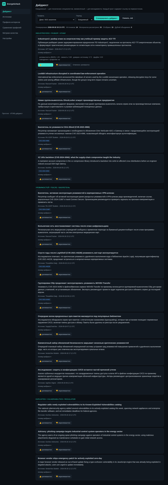
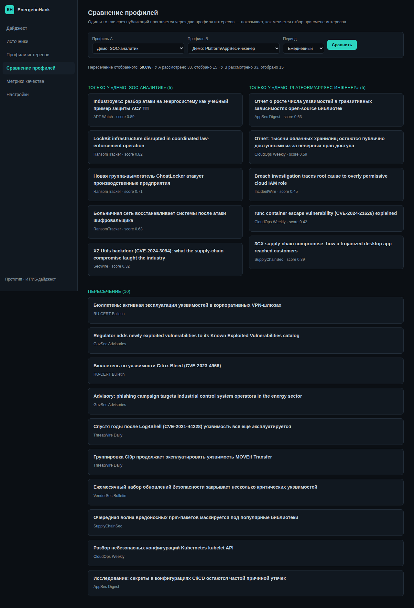
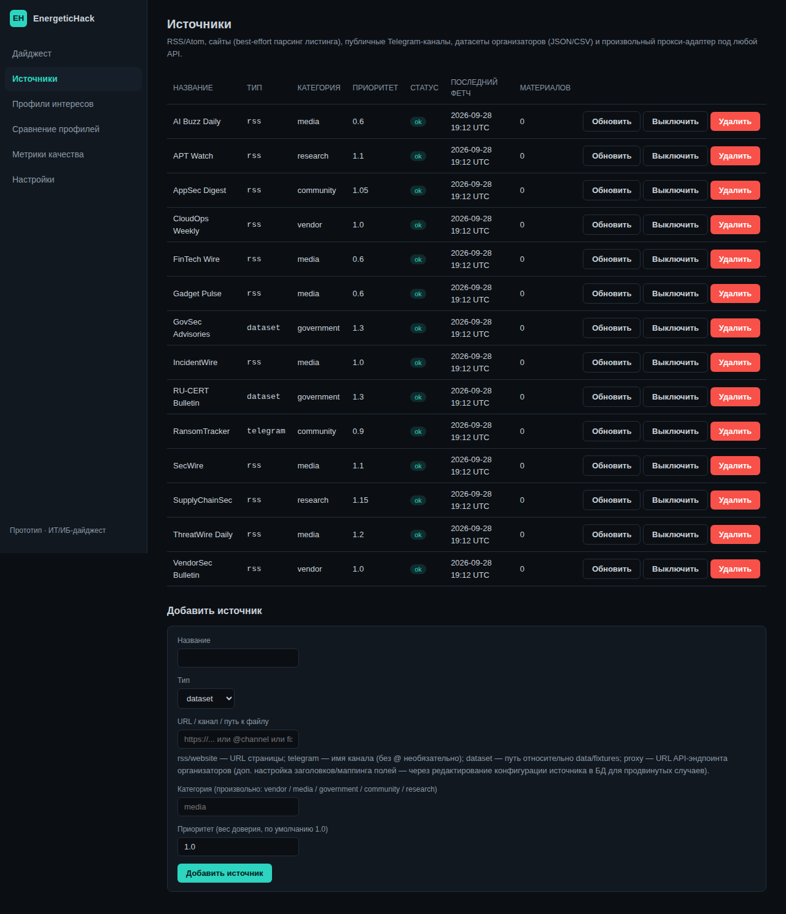
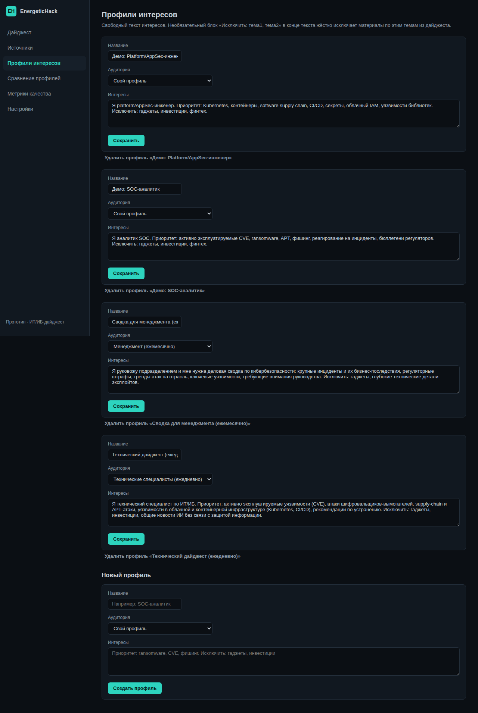
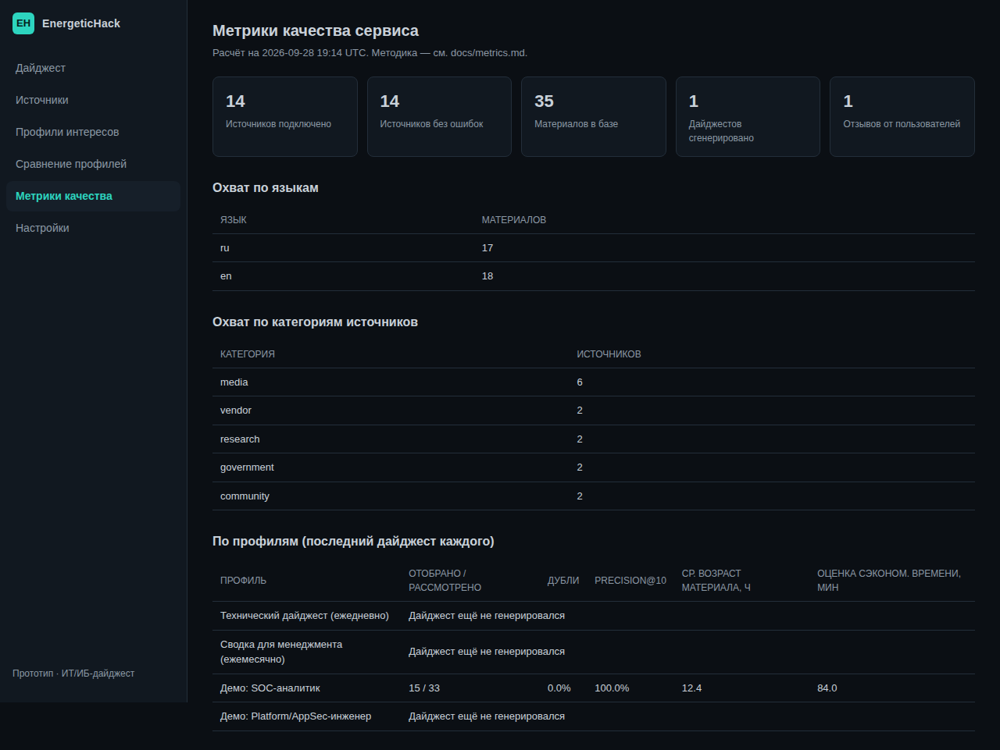
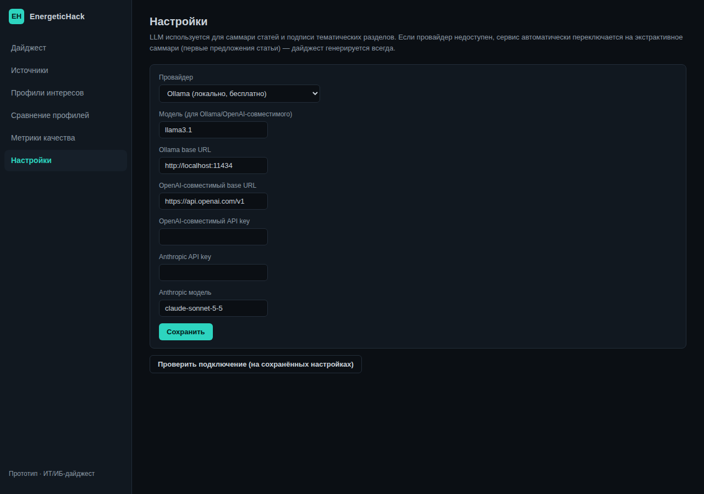

# EnergeticHack — ассистент для ИТ/ИБ-дайджестов

Независимый веб-сервис, который собирает публикации из произвольного числа
источников (RSS, сайты, публичные Telegram-каналы, датасеты и API
организаторов), отбирает и группирует их по профилю интересов пользователя,
и формирует Markdown-дайджест со ссылками на первоисточник на каждый пункт.

Сделано для трека «Ассистент для создания ИТ/ИБ-дайджестов» — широкого
профиля, без привязки к энергетической специфике (её и не требуется).

## Как это выглядит

Тёмная SOC-панель, боковая навигация, 6 разделов.

<table>
<tr>
<td width="50%">

**Дайджест** — карточки по темам, ссылка на первоисточник, «почему выбрано»
(разбивка скора), фидбек 👍/👎 прямо на карточке.



</td>
<td width="50%">

**Сравнение профилей** — один и тот же срез публикаций через два профиля:
видно, что попало только в один из них, а что пересекается.



</td>
</tr>
<tr>
<td width="50%">

**Источники** — таблица со статусом здоровья, ручной фетч, добавление
нового источника любого из 5 типов.



</td>
<td width="50%">

**Профили интересов** — свободный текст интересов на каждый профиль, с
опциональным блоком `Исключить: ...`.



</td>
</tr>
<tr>
<td width="50%">

**Метрики качества** — precision@10, доля дублей, охват по языкам/
категориям источников, оценка сэкономленного времени.



</td>
<td width="50%">

**Настройки** — выбор LLM-провайдера (Ollama / OpenAI-совместимый /
Anthropic / без LLM) и проверка подключения одной кнопкой.



</td>
</tr>
</table>

## Ключевые возможности

- **Источники**: RSS/Atom, best-effort парсинг сайтов-листингов, публичные
  Telegram-каналы, датасеты организаторов (JSON/CSV), произвольный
  прокси-адаптер под любой HTTP/JSON API. Подробности — `docs/sources.md`.
- **Профили интересов**: свободный текст + опциональное жёсткое исключение
  тем (`Исключить: ...`). Разделение аудиторий: ежедневный технический
  дайджест и ежемесячная сводка для менеджмента.
- **Ранжирование**: гибрид BM25 (классический алгоритм поискового
  ранжирования) + свежесть + доверие к источнику + обучение на фидбеке
  пользователя (Rocchio-подобный сигнал). У каждого пункта — блок «почему
  выбрано» с разбивкой по компонентам.
- **Дедупликация**: точная (по нормализованному URL) + нечёткая
  (rapidfuzz, в окне времени) — похожие публикации из разных источников
  объединяются, ссылки на все сохраняются.
- **Кластеризация тем**: TF-IDF + KMeans, подпись раздела — от LLM либо
  детерминированный fallback по ключевым словам.
- **LLM — подключаемый, не обязательный**: по умолчанию локальный Ollama;
  можно переключить на любой OpenAI-совместимый API/OpenRouter или Anthropic
  Claude API прямо из страницы «Настройки». Если LLM недоступен — сервис
  автоматически переходит на экстрактивное саммари, дайджест генерируется
  всегда.
- **Фидбек и обучение**: 👍/👎 на каждой карточке дайджеста, влияет на
  будущее ранжирование для этого профиля.
- **Сравнение профилей**: один и тот же срез публикаций прогоняется через
  два профиля — наглядно показывает, как меняется отбор при смене
  интересов (ключевое демо-требование задания).
- **Метрики качества**: precision@10, доля дублей, охват источников/языков,
  средний возраст отобранных материалов, оценка сэкономленного времени.
  Методика — `docs/metrics.md`.

## Быстрый старт

**Требования:** Python 3.11–3.13 (совсем свежие релизы вроде 3.14 могут
ещё не иметь готовых wheel-пакетов под numpy/scikit-learn на некоторых
платформах — тогда pip будет пытаться собирать их из исходников и падать).

Самый простой способ — запустить скрипт настройки, он сам найдёт
подходящую версию Python (даже если в системе по умолчанию стоит другая) и
поставит окружение:

```bash
# Linux/macOS
./setup_unix.sh
```
```powershell
# Windows — просто дважды кликнуть setup_windows.bat, или в PowerShell:
.\setup_windows.bat
```

Либо вручную:
```bash
python3 -m venv .venv
source .venv/bin/activate   # Windows: .venv\Scripts\activate
pip install -r requirements.txt
```

Дальше в любом случае:
```bash
# демо-прогон без веб-сервера: сеет фикстуры и генерирует .md для всех демо-профилей
python -m scripts.run_demo --period daily
# результат: data/digests/*.md

# веб-интерфейс
uvicorn app.main:app --host 0.0.0.0 --port 8899
# открыть http://localhost:8899
```

По умолчанию используется локальный Ollama (`http://localhost:11434`,
модель `llama3.1`) — если он не запущен, саммари автоматически становятся
экстрактивными (первые предложения статьи), без ошибок. Чтобы подключить
OpenAI-совместимый API или Anthropic — раздел «Настройки» в интерфейсе или
`.env` (см. `.env.example`).

### Демо-профили и корпус

`scripts/seed_fixtures.py` (вызывается автоматически из `run_demo.py`)
загружает `data/fixtures/articles_sample.json` — 35 примеров публикаций
(RU/EN, микс государственных бюллетеней, вендорских адвайзери, независимой
журналистики и исследовательских источников; реальные исторические CVE —
Log4Shell, MOVEit, XZ backdoor, PrintNightmare и др. — с точными фактами,
плюс синтетический шум для демонстрации фильтрации) и 4 профиля:
технический ежедневный, менеджмент ежемесячный, и два демо-профиля
(«SOC-аналитик» / «Platform-AppSec-инженер») специально для страницы
сравнения — на одном и том же срезе публикаций они дают заметно разную
выборку.

Почему фикстуры, а не живой сбор в примерах: воспроизводимость демо не
должна зависеть от того, что отвечают внешние сайты прямо сейчас. Реальные
адаптеры (`app/sources/rss.py`, `website.py`, `telegram.py`) полностью
рабочие и добавляются через страницу «Источники» — просто не участвуют в
`run_demo.py`, где важен детерминированный воспроизводимый прогон.

Кандидаты в реальные источники для продакшен-конфигурации (проверялись на
доступность на этапе ресёрча): Habr «Информационная безопасность», Xakep,
Securelist, The Hacker News, BleepingComputer, KrebsOnSecurity, CISA
advisories, Google Project Zero, MSRC, Cloudflare blog, GitHub Security —
и любые официальные RSS-фиды регуляторов/CERT.

## Тесты

```bash
pip install -r requirements-dev.txt
pytest
```
40+ тестов: парсинг всех 5 адаптеров источников на зафиксированных
примерах (без сети), дедуп (точный/нечёткий/по времени), ранжирование
(исключения по профилю, смена профиля меняет топ, буст от фидбека,
диверсификация по источникам), кластеризация, детерминированность и
сохранность ссылок в Markdown, graceful fallback LLM-провайдеров,
end-to-end сборка дайджеста на реальной БД, smoke-тесты всех веб-роутов.

## Структура проекта

```
app/
  sources/     # адаптеры источников (rss, website, telegram, dataset, proxy)
  pipeline/    # normalize, dedup, ranking, clustering — DB-agnostic, тестируемые
  llm/         # LLMProvider интерфейс + ollama/openai/anthropic + extractive fallback
  digest/      # оркестрация сборки дайджеста + рендер Markdown
  api/         # FastAPI-роутеры (по одному файлу на раздел UI)
  templates/, static/  # тёмный SOC-интерфейс (Jinja2 + CSS + минимальный JS)
  models.py, schemas.py, config.py, db.py, metrics.py, scheduler.py
scripts/       # seed_fixtures.py, run_demo.py
data/fixtures/ # демо-корпус публикаций
data/digests/  # сюда пишутся сгенерированные .md
tests/         # pytest
docs/          # architecture.md, metrics.md, sources.md
```

## Ограничения (честно, как просят организаторы)

- **`website`-адаптер** — best-effort: заголовок/ссылка/тизер прямо со
  страницы листинга, без захода на саму статью (иначе парсинг перестаёт
  быть чистой функцией, тестируемой без сети). Для полного текста —
  `rss` или `dataset`/`proxy`.
- **Определение языка** — эвристика по соотношению кириллицы/латиницы, а
  не полноценная NLP-модель; для RU/EN достаточно, для прочих языков не
  тестировалось.
- **Исключение тем в профиле** (`Исключить: ...`) сопоставляется по
  токенам-префиксам того же языка, что и сам профиль — межъязыковое
  исключение (русский профиль исключает англоязычную тему) не работает.
- **Кластеризация** — TF-IDF+KMeans, не эмбеддинги: работает офлайн без
  скачивания моделей, но менее семантически точна, чем embedding-based
  подход на действительно больших/разнородных корпусах.
- **Precision@10** считается только там, где есть фидбек пользователя —
  это честное ограничение, а не баг: без разметки метрика недостоверна.
- Эта песочница-контейнер не имела исходящего доступа в интернет на момент
  разработки, поэтому демо и тесты работают на фикстурах; live-адаптеры
  (`rss`/`website`/`telegram`) не тестировались против реальной сети, но
  устроены штатно (`httpx` + стандартные заголовки) и должны работать
  сразу при запуске с доступом в интернет.

## Что сдаётся по заданию первого этапа

- Рабочий прототип: веб-интерфейс (`uvicorn app.main:app`) + CLI
  (`scripts/run_demo.py`).
- Исходный код и инструкция запуска — этот README.
- Примеры входных данных — `data/fixtures/articles_sample.json`; примеры
  результатов — `data/digests/*.md` после `run_demo.py`, плюс скриншоты
  выше.
- Возможности/ограничения — разделы выше и `docs/architecture.md`.
